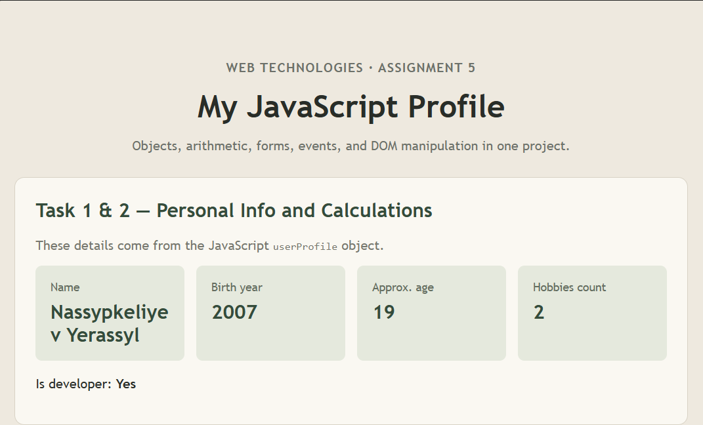
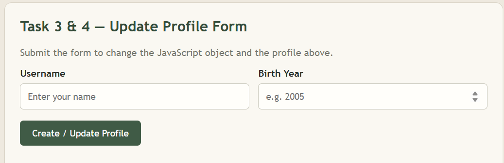
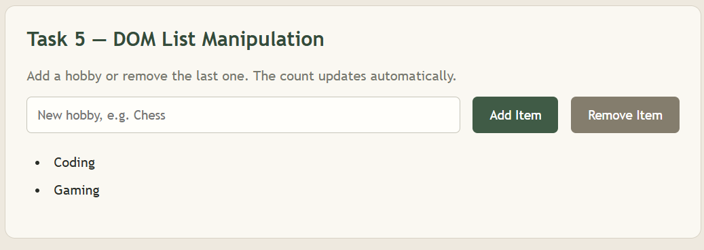

# Assignment 5 — JavaScript Basics (DOM Manipulation & Events)

**Student:** Nassypkeliyev Yerassyl  
**Group:** SE2538  
**Course:** Web Technologies

## Project description
This single-page project demonstrates JavaScript objects, data types, arithmetic, HTML forms, event handling, and DOM list manipulation.

## Task 1 — Personal Info Object
Created the `const userProfile` object with `name` (string), `birthYear` (number), `isDeveloper` (boolean), and `hobbies` (array).

## Task 2 — Arithmetic Calculations
Calculates approximate age from the current year and birth year, counts hobbies with `.length`, and displays results on the page and in the browser console.

<!--  -->

## Task 3 — HTML Form Setup
Added a Username field, a Birth Year field, and a Create / Update Profile submit button.

## Task 4 — Event Listener
Used `addEventListener('submit', ...)` to read input values, update `userProfile`, and refresh the displayed profile without reloading the page.

<!--  -->

## Task 5 — DOM List Manipulation
Used `createElement('li')` and `appendChild()` to add a hobby, and `lastElementChild.remove()` to delete the last hobby. The array and hobby count are also updated.

<!--  -->

## Work process
I created the HTML structure, styled it with CSS, and wrote JavaScript functions for profile calculations, form submission, and list events. I tested both profile updates and Add/Remove Item buttons in the browser.

## Technologies
HTML5, CSS3, JavaScript (DOM manipulation and events).

## How to run
Open `index.html` in any modern browser. Open Developer Tools (F12) → Console to see the calculations.

## GitHub Pages
Publish from the `main` branch, root folder, in **Settings → Pages**.

**Repository link:** Add your public GitHub repository URL here.  
**Live site:** Add your GitHub Pages URL here.

## Screenshots required before submission
Create a `screenshots` folder and save screenshots named `task1.png`, `task2.png`, `task3.png`, `task4.png`, and `task5.png`. Uncomment each matching Markdown image line above after adding the real file. For Task 2, include the console if possible. For Task 4, show the updated profile; for Task 5, show the list after clicking Add Item.
